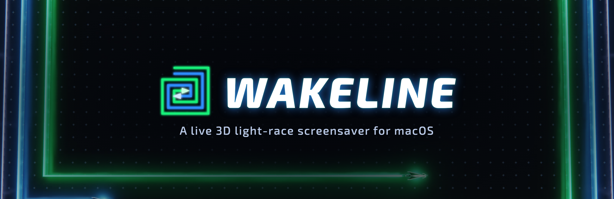
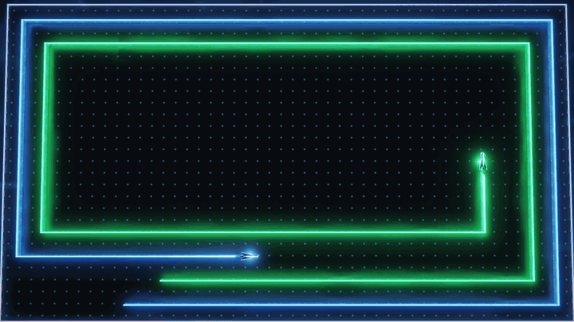
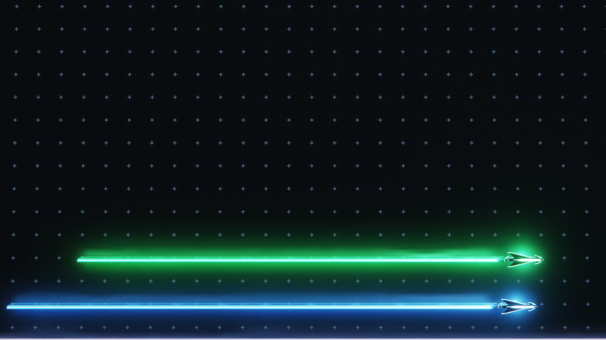
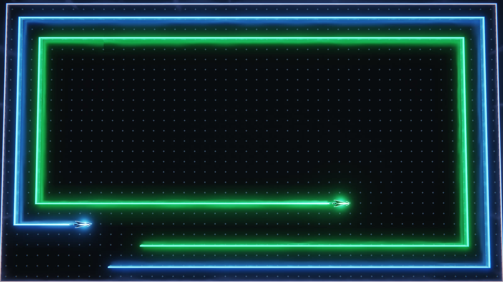
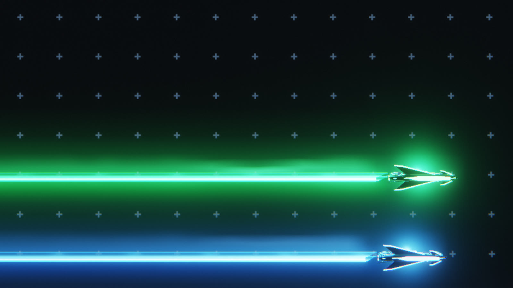
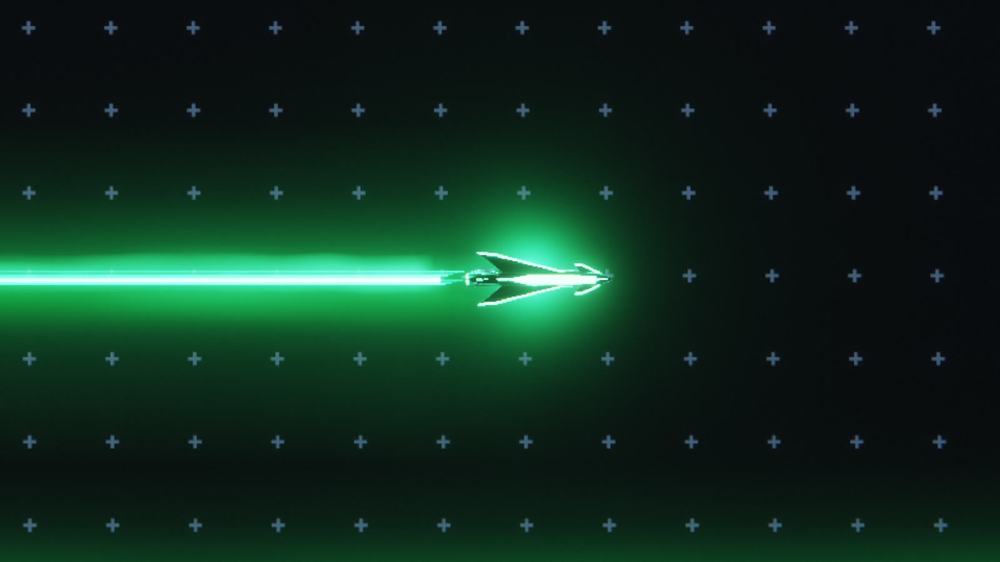
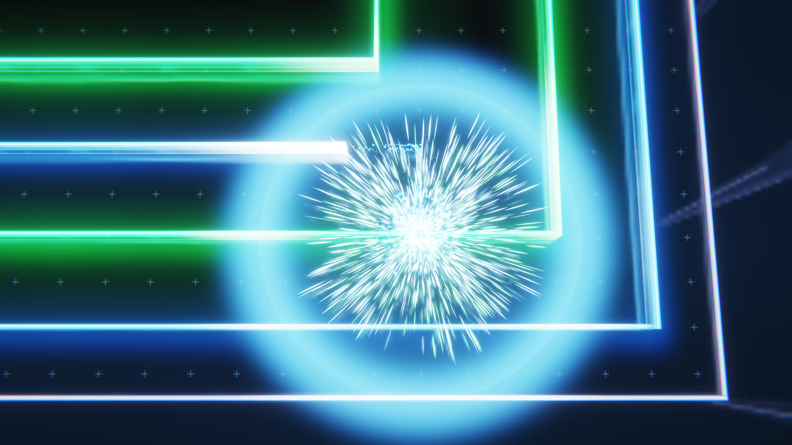
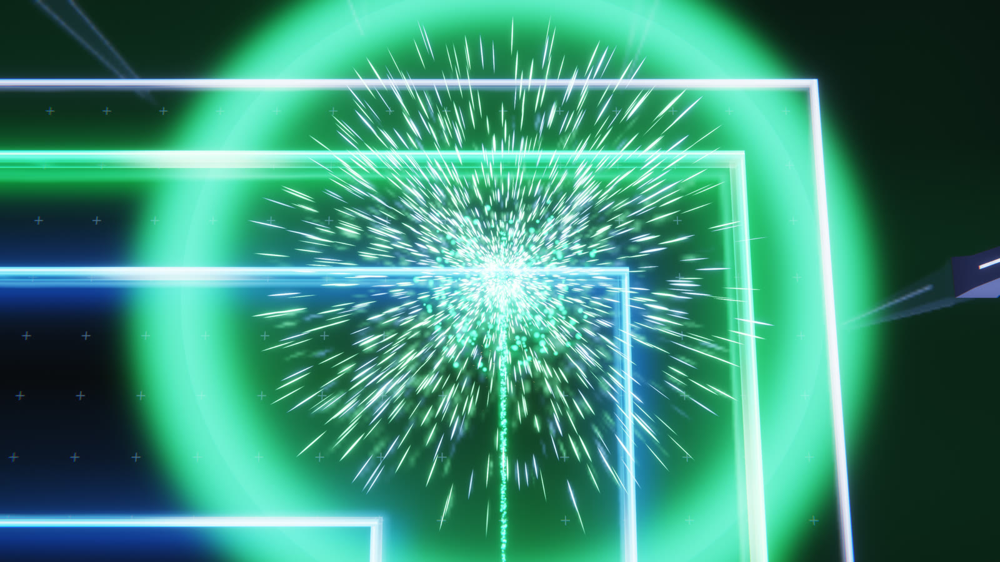

<p align="center"></p>

<p align="center">
  
  
  
  
</p>

Two bikes race around your screen and wrap it in glowing walls, lap inside lap. At a random moment one bike swerves into the other's trail and blows up. The walls burn away and a new race starts.

Wakeline renders every frame live, so each race plays out differently.

<p align="center"></p>

## Screenshots

| Side by side | Lap after lap |
| --- | --- |
|  |  |
|  |  |

| Blue goes down | Green goes down |
| --- | --- |
|  |  |

## What you get

- **A new race each time.** The crash time, the loser, the lane width and the spiral direction all come from a random roll.
- **An overhead camera.** You see the whole maze, then the camera drops in on the crash in slow motion.
- **A mirror floor.** Bikes, walls and sparks reflect in black glass.
- **One race per display.** Three screens get three separate races.
- **No dependencies.** Swift, Metal and nothing else.

## Install

You need an Apple Silicon Mac on macOS 14 or later, plus Apple's Command Line Tools. You don't need Xcode. We test on macOS 26.5, so older versions may need a tweak.

```bash
git clone https://github.com/1upcreative/wakeline.git
```

```bash
cd wakeline
```

```bash
./build.sh
```

```bash
./install.sh
```

Open **System Settings**, click **Screen Saver**, and pick **Wakeline**.

`install.sh` installs for your user account only. If you already have a copy, it moves the old one to `~/Library/Application Support/Wakeline` first.

## Try it before you install

The build also makes a preview app that runs the same engine in a window:

```bash
open "build/Wakeline Preview.app"
```

Press **F** for full screen, **N** for the next race, and **Esc** to quit.

## Uninstall

Open `~/Library/Screen Savers` in Finder and move `Wakeline.saver` to the Trash.

## Privacy

Wakeline collects nothing. It has no network code, no accounts and no tracking. It asks for no permissions and saves no files.

## Under the hood

| Part | Where |
| --- | --- |
| Race rules and bike AI | `Sources/Core/Race.swift` |
| Camera | `Sources/Core/Director.swift` |
| Sparks and explosions | `Sources/Core/World.swift`, `Sources/Core/Particles.swift` |
| Metal renderer | `Sources/Core/Renderer.swift` |
| Shaders | `Resources/Wakeline.metal` |
| Bike model, built in headless Blender | `tools/build_assets.py` |
| macOS screensaver wrapper | `Sources/Saver/WakelineSaverView.swift` |

Wakeline compiles its bundled shaders when it starts. It downloads nothing.

To test the race rules without opening a window, run this after a build:

```bash
"build/Wakeline Preview.app/Contents/MacOS/Wakeline Preview" --simtest 1000
```

## Security

See [SECURITY.md](SECURITY.md).

## License

MIT. See [LICENSE](LICENSE).
